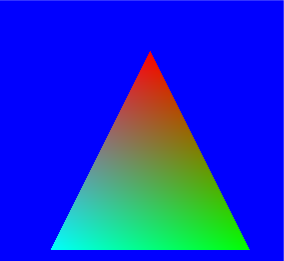
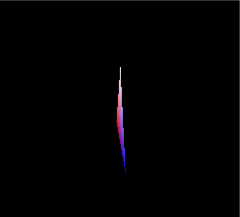
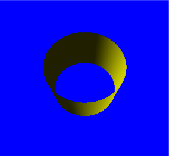
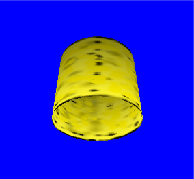

# Portico

[](https://github.com/matteodante/portico/actions/workflows/ci.yml)
[](https://github.com/matteodante/portico/actions/workflows/demo.yml)

**Run Direct3D 9 C++ programs in the browser, from source, without rewriting them.**

Portico implements the Windows APIs an old C++ game or tool calls (starting with Direct3D 9's fixed-function
pipeline) on top of what a browser offers, so the program's own code compiles unchanged with
[Emscripten](https://emscripten.org) and runs in a tab. The same code also runs natively on Windows over
[ANGLE](https://chromium.googlesource.com/angle/angle), where it is tested against the real Direct3D 9 runtime.

**[Live demo](https://matteodante.it/portico-demo/index.html)** — Microsoft's Direct3D 9 tutorials 1–5, compiled unchanged.

The demo is hosted on matteodante.it. The **Live demo** check verifies the published tutorials and license notices;
the **CI** check builds and tests the source in this repository. See [hosting and checks](docs/testing.md#live-demo).

[Technical article: running Direct3D 9 C++ programs in the browser](https://matteodante.it/en/blog/portico-direct3d9-webgl2).

| | | | | |
|---|---|---|---|---|
|  |  |  |  |  |

<sub>Reference renders of the real Direct3D 9; Portico's renders of the same frames match them (see [Parity](#parity)).</sub>

## Why

There are good ways to run an old Windows game in a browser when all you have is the `.exe`: emulate the CPU and
reimplement Windows around it ([BottleShip](https://github.com/jenissimo/bottleship),
[Boxedwine](https://github.com/danoon2/Boxedwine)). And there are single-game source ports that replace the
platform code by hand. Portico is for the case in between: **you have the C++ source, and you want the original
program, not a rewrite**. It keeps the program's own threads, loops and blocking calls, and gives it the API it
expects.

Portico was extracted from a private port of a whole 2000s Windows MMO client (about 400,000 lines of C++ using
MFC, Win32, Direct3D 9 and DirectSound) to the browser, tested against a private local server instance. The pieces
that are not specific to that program are being published here, one module at a time. How that port was done, and
what was measured, is in the write-up: [Porting a 400,000-line Windows MMO client to the browser without rewriting
it](https://github.com/matteodante/matteodante/blob/main/articles/porting-a-windows-mmo-client-to-the-browser.md).

## What's in it

| Module | Status | What it does |
|---|---|---|
| `portico::d3d9` | **v0.1** | Direct3D 9 fixed-function pipeline on OpenGL ES 3: WebGL2 in the browser, ANGLE natively. Fixed-function state becomes generated GLSL, one program per state combination. |
| `portico::d3dx` | **v0.1** | D3DX 9 math (vectors, matrices, quaternions, planes, colors) and texture loading (DDS with DXT, TGA, BMP, PNG), over any `IDirect3DDevice9`. |
| `portico::win32` | **v0.1, minimal** | For the browser: windows bound to the page's canvas, the message queue with `PeekMessage`/`GetMessage`, input from the canvas, timers, `wWinMain`/`WinMain` as the entry point. |
| More game-facing Win32 APIs, MFC subset, DirectSound 8, Winsock over WebSocket, OPFS asset installer | [planned](ROADMAP.md) | The rest of the platform layer of the original port, to be extracted and tested independently. |

The current fixed-function pipeline supports up to 8 lights (directional, point,
spot), materials and vertex colors, 8 texture stages with the texture blending operations (except bump-environment
mapping), texture coordinate generation and transforms, vertex blending (indexed too), linear/exp/exp2 fog, alpha
test, alpha blending, depth and stencil, multiple vertex streams, DXT textures, render targets. It does **not** run
programmable shaders yet.
The details are in [docs/supported-api.md](docs/supported-api.md).

The [roadmap](ROADMAP.md) gives the proposed development sequence. The
[ecosystem coverage plan](docs/ecosystem-coverage.md) tracks graphics gaps, platform dependencies, input, audio,
networking, media, optional legacy components and browser constraints; these are future work, not current support.

## How it works

A program written for Windows never gives control back: its main loop runs forever. Portico keeps that loop as it
is and, after every `Present`, suspends the program's WebAssembly stack until the browser's next animation frame,
using [JSPI](https://v8.dev/blog/jspi) (WebAssembly JavaScript Promise Integration). The browser shows the frame
and runs its events; `Present` returns; the loop goes on. `GetMessage` and `Sleep` also yield through JSPI.
Long CPU work and waits that do not yield can still stall the page. A worker setup, with the canvas transferred
to that thread as an `OffscreenCanvas`, is [next](ROADMAP.md).

More in [docs/architecture.md](docs/architecture.md).

## Browser support

JSPI is required: **Chrome and Edge 137+, Firefox 153+, Safari 27+** (Safari has not been tested yet).

## Quick start

Requirements: CMake 3.21+, [Emscripten](https://emscripten.org/docs/getting_started/downloads.html) (tested with
6.0.12), Ninja, Node.js and Python 3 with Pillow for the tests. Clone with the submodule:

```sh
git clone --recursive https://github.com/matteodante/portico
cd portico
emcmake cmake -S . -B build/web -G Ninja -DCMAKE_BUILD_TYPE=Release
cmake --build build/web
ctest --test-dir build/web            # D3DX math tests, under Node.js
npx http-server build/web/samples     # then open tut05_textures.html
```

Natively on Windows (Visual Studio 2022), with ANGLE from [vcpkg](https://vcpkg.io) (`vcpkg install angle`) or a
folder with ANGLE's `include/`, `lib/` and `bin/`:

```sh
cmake -S . -B build/native -A Win32 -DPORTICO_ANGLE_DIR=<angle>
cmake --build build/native --config Release
```

To port your own program, see [docs/porting-guide.md](docs/porting-guide.md).

## Parity

Every sample is rendered three ways from the same source: with the system's Direct3D 9, with Portico natively
(ANGLE), and with Portico in the browser. The renders are compared tile by tile ("the same to the eye": a mean
difference of at most 8/255 overall and 20/255 in any 32×32 tile). Latest results (October 2026), mean difference
from Direct3D 9 on a 0–255 scale:

| Sample | Portico native (ANGLE) | Chromium (GPU) | Chromium (SwiftShader) | Firefox |
|---|---|---|---|---|
| Tutorial 1: CreateDevice | 0.000 | 0.263 | 0.263 | 0.263 |
| Tutorial 2: Vertices | 0.000 | 0.367 | 0.380 | 0.367 |
| Tutorial 3: Matrices | 0.000 | 0.538 | 0.541 | 0.538 |
| Tutorial 4: Lights | 0.007 | 0.410 | 0.408 | 0.410 |
| Tutorial 5: Textures | 0.000 | 0.485 | 0.506 | 0.485 |

The browser figures are dominated by the window corners that Windows 11 rounds in the reference captures. CI checks
the browser renders against the committed references on every push ([docs/testing.md](docs/testing.md)).

## Compared with

| | Portico | [d3d9-webgl](https://github.com/LostMyCode/d3d9-webgl) | [BottleShip](https://github.com/jenissimo/bottleship) |
|---|---|---|---|
| Input | C++ source | C++ source | The original `.exe` |
| Approach | API layer, compiled with the program | API layer, compiled with the program | x86 emulation + reimplemented Windows APIs |
| Direct3D 9 fixed function | 8 lights, 8 stages, vertex blending, fog modes, multiple streams | 3 point lights, stream 0, linear fog | Direct3D 3–9 on WebGPU |
| Tested against real Direct3D 9 | Yes, screenshot parity | — | — |
| Beyond graphics | Win32 (minimal, more planned) | — | Win32, DirectDraw, DirectSound |

Pick BottleShip when you only have the binary. Pick Portico when you have the source and want the program itself,
debuggable natively and in the browser.

## Repository layout

```
modules/d3d9     Direct3D 9 on GLES3 / WebGL2
modules/d3dx     D3DX 9 math and texture loading
modules/win32    the Win32 subset for the browser (and the Direct3D 9 headers there)
samples/         Microsoft's Direct3D 9 tutorials 1-5 (MIT), unchanged
tests/           unit tests and the Direct3D 9 reference renders
tools/           screenshot capture and comparison
external/        MinGW-w64 DirectX headers (submodule, browser builds only)
docs/            architecture, porting guide, supported API, testing
```

## Contributing

Issues and pull requests are welcome: see [CONTRIBUTING.md](CONTRIBUTING.md). Security reports:
[SECURITY.md](SECURITY.md).

## License

[Mozilla Public License 2.0](LICENSE), copyright (c) 2026 Matteo Dante. Portico can be used in any program, open or
closed, free or commercial. When distributing Portico binaries, make the corresponding MPL-covered source,
including any changes, available under MPL-2.0 and tell recipients how to obtain it. Distributed source stays
under MPL-2.0; separate application files containing no MPL-covered code can keep their own licenses.
Private modifications do not have to be published. Third-party components
and their licenses are listed in [THIRD_PARTY_NOTICES.md](THIRD_PARTY_NOTICES.md); the samples are Microsoft's, under
the MIT license.

Portico is developed by Matteo Dante, with AI coding agents (Anthropic's Claude) writing much of the code under his
direction and review. Direct3D, DirectX and Windows are trademarks of Microsoft; Portico is not affiliated with
Microsoft.
