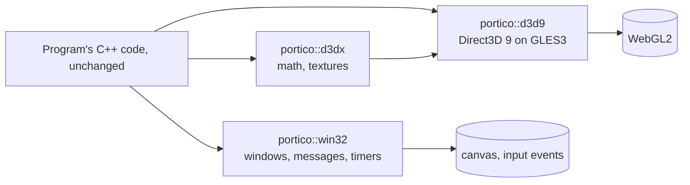
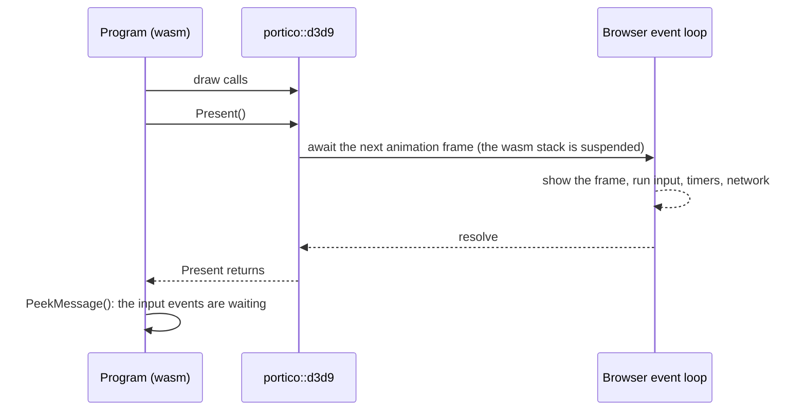

# Architecture

Portico runs a program written for Windows in the browser by giving it the Windows APIs it calls, implemented over
browser APIs. The program's code is not changed: it is compiled with Emscripten and linked against Portico's
modules instead of Windows' DLLs.



## The loop that never returns

A Windows program's main loop looks like this, and it never gives control back to anyone:

```cpp
while (msg.message != WM_QUIT) {
    if (PeekMessage(&msg, NULL, 0, 0, PM_REMOVE)) { TranslateMessage(&msg); DispatchMessage(&msg); }
    else Render();   // ... device->Present(...)
}
```

A browser shows a frame, delivers input and runs timers and network callbacks only when JavaScript returns to the
event loop. The usual fix is to turn the loop inside out (`emscripten_set_main_loop`), which means changing the
program. Portico does not: after every `Present`, the Direct3D 9 layer calls `portico_present_frame()`, which waits
for the next `requestAnimationFrame` through **JSPI**:



JSPI (WebAssembly JavaScript Promise Integration) lets a WebAssembly call wait for a JavaScript promise: the engine
suspends the WebAssembly stack and resumes it later, with no rewriting of the code (unlike Asyncify, which
instruments every function that may be on the stack). `EM_ASYNC_JS` functions use it when the program is linked
with `-sJSPI`; Portico's targets add that flag.

`GetMessage` with an empty queue waits the same way, until an input event arrives (or 100 ms pass).
`Sleep(ms)` calls Emscripten's asynchronous sleep, yielding through JSPI until its timer completes.

## Threads

**Main thread (v0.1).** The program runs on the page's main thread; `#canvas` holds the WebGL2 context. It
needs no special HTTP headers, so it works on static hosts. The demo runs on matteodante.it; GitHub Pages is an
optional manual deployment. `Present`, `GetMessage` and `Sleep` yield to the browser; long CPU work and
non-yielding waits can still stall the page.

**Worker (next).** For programs that need blocking waits or long CPU work, the planned setup runs the program
on a pthread (`-sPROXY_TO_PTHREAD`), with `#canvas` transferred to that thread as an `OffscreenCanvas` and the
WebGL2 context created there, so no GL call ever waits for another thread. The Direct3D 9 module already creates its
context that way (`gl_context_web.cpp`); `portico::win32` does not forward the page's input to the worker yet, so the
build does not offer this setup. Threads need `SharedArrayBuffer`, so such a page must be cross-origin isolated
(`Cross-Origin-Opener-Policy: same-origin`, `Cross-Origin-Embedder-Policy: require-corp`).

## Direct3D 9 on GLES3

`modules/d3d9` implements `IDirect3D9`, `IDirect3DDevice9` and the resource interfaces over OpenGL ES 3.0, the API
WebGL2 exposes. The same code runs natively over ANGLE in WebGL-compatibility mode, so a program can be debugged
natively (with a debugger and RenderDoc) and compared with the system's Direct3D 9 in the same process.

- **Fixed-function pipeline.** The fixed-function state (lights, materials, texture stages, fog, vertex blending,
  texture coordinate generation) is packed into a key; each key gets a generated GLSL ES 3.00 program (`ffp.cpp`),
  compiled once and cached. Per-draw values go in uniforms.
- **Threads.** GL is used only on the thread that created the device. With `D3DCREATE_MULTITHREADED`, calls from
  other threads update the CPU-side state at once (so `Get*` answer) and queue their GL work; the device's thread
  runs the queue in call order before its own next call, or in `Portico_D3D9_Service()`. A queued call never waits
  for the GL thread, which keeps a loader thread drawing a loading screen from deadlocking against a main thread
  that waits for it.
- **Resources.** Locks write into a CPU copy; the GL object is created or updated lazily on the GL thread. Static
  buffers of 4 KB and more keep no CPU copy (a large memory saving for real programs); bytes are read back from GL
  when a later lock needs them. Textures keep theirs, as the managed pool does; `PORTICO_D3D9_DROP_TEXTURE_COPY=1`
  frees it once a level is uploaded, for programs that never lock a texture again after using it.
- **State cache.** GL state and bindings are cached, so programs that set the same state again and again (most do)
  cost no GL calls.
- **Presentation.** The back buffer is a framebuffer of the layer's own, blitted to the canvas at `Present`.

## D3DX

`modules/d3dx` implements the D3DX 9 math library (header and functions, written from the public documentation)
and texture loading. The loaders decode DDS, TGA, BMP and PNG into 32-bit ARGB and convert to the requested format,
or upload DXT data as it is. They only use the `IDirect3DDevice9` interface, so they also work with the system's
Direct3D 9: the reference renders of the tests use Portico's D3DX with the real Direct3D 9.

## Win32

`modules/win32` (browser builds) provides `windows.h` and friends, and implements the subset that the samples and
the other modules need. The first window created is bound to the page's `#canvas`; its client area has the size
Windows 10/11 would give a window of the same outer size and style, so the back buffer, and the rendered image, are
the same size as on Windows. Input events of the canvas are queued on the JavaScript side and taken by
`PeekMessage`/`GetMessage`: no JavaScript handler ever calls into the program while it runs.

The Direct3D 9 headers for browser builds come from the MinGW-w64 headers (a git submodule under
`external/`, LGPL-2.1+); only `d3d9.h`, `d3d9types.h` and `d3d9caps.h` are reachable, through three forwarding
headers in `modules/win32/include`. Windows builds use the Windows SDK's headers.
